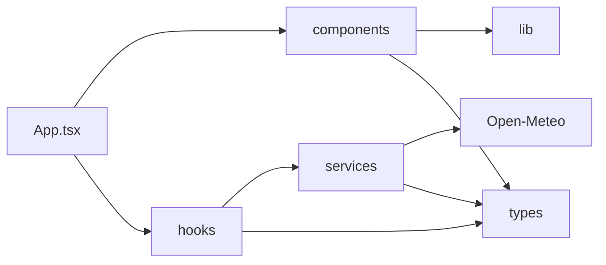
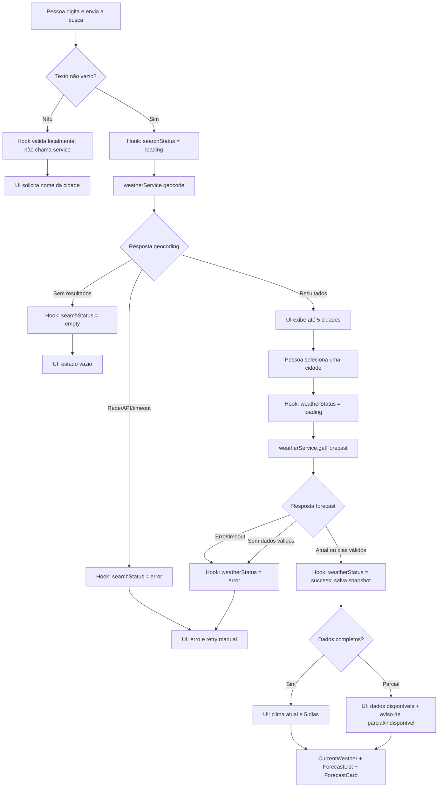

# Plano Técnico — Aplicação de Previsão do Tempo

## Architecture

Aplicação SPA no navegador, sem backend próprio, dividida em quatro responsabilidades. `App` conecta o hook aos componentes de apresentação; componentes não acessam a rede nem mantêm cópias paralelas do estado de domínio. O hook coordena busca, seleção, consulta e retry manual. Services encapsulam chamadas e convertem DTOs externos para o modelo interno. `lib` mantém regras determinísticas sem efeitos colaterais.



Direção de dependência: `App → hooks → services → Open-Meteo`; `App → components` por props. `components`, `hooks` e `services` podem consumir contratos de `types`; componentes podem usar funções puras de `lib`. Nenhuma camada inferior conhece React ou componentes. Uma busca de geocoding ocorre ao enviar a consulta; após seleção explícita, forecast traz clima atual e previsão diária. Sem backend, persistência, polling ou retry automático.

**Rastreabilidade:** FR-1/US-1: AC-1.1–AC-1.6; FR-2/US-3: AC-2.1–AC-2.6; FR-3/US-2: AC-3.1–AC-3.5; FR-4/US-4 e US-5: AC-4.1–AC-4.6. NFR-1 a NFR-6 são transversais conforme a matriz da spec.

## Tech Stack

- **React 19 + TypeScript strict + Vite:** stack existente para a SPA e componentes tipados.
- **Tailwind CSS:** sistema de estilo já configurado no projeto; layout responsivo conforme NFR-1.
- **Open-Meteo Geocoding e Forecast:** fonte definida pela spec, sem chave de API.
- **Vitest + Testing Library:** testes unitários e de componentes; **Playwright:** testes E2E e validação de viewports/navegadores.
- **Biome + pnpm:** lint, formatação e execução conforme scripts existentes.
- Não adicionar dependências de estado global, cache de dados ou cliente HTTP enquanto `fetch` nativo atender aos contratos.

## Project Structure

Manter a organização existente e evitar subcamadas sem necessidade:

```text
src/
  App.tsx                  # compõe o hook e injeta props nos componentes
  main.tsx                 # bootstrap da aplicação
  components/              # apresentação e interação acessível
    SearchBar.tsx          # valor/submit via props; sem geocoding próprio
    CurrentWeather.tsx     # clima atual e indicador de atualização
    ForecastList.tsx       # lista de dias
    ForecastCard.tsx       # apresentação de um dia
    UnitToggle.tsx         # seleção de unidade via props
    states/                # loading, vazio e erro
  hooks/
    useWeather.ts          # estado e orquestração do fluxo meteorológico
  services/
    weatherService.ts      # HTTP, timeout, DTOs e mapeamento para domínio
  lib/                     # funções puras, sem React e sem I/O
    temperature.ts         # conversão e arredondamento
    weatherCodes.ts        # código WMO para descrição pt-BR
    format.ts              # datas/horas no fuso e locale definidos
  types/
    weather.ts             # modelos de domínio e contratos compartilhados
```

Responsabilidades e limites:

- **components:** recebem dados, estado visual e callbacks por props; não fazem `fetch`, não interpretam DTOs Open-Meteo e não decidem política de retry.
- **hooks:** coordenam transições `idle/loading/success/empty/error`, seleção da cidade, concorrência/obsolescência de respostas, unidade da sessão e retry manual; não contêm detalhes de URL ou parsing do provedor.
- **services:** são o único limite de I/O; recebem parâmetros de domínio, chamam Open-Meteo, tratam timeout/resposta e retornam tipos internos ou erro de serviço tipado.
- **lib:** funções puras para conversão, formatação e códigos; não acessam rede, relógio global ou estado React. Valores de tempo usados para validação devem ser recebidos como argumento.
- **types:** contratos compartilhados sem dependência de runtime; DTOs do provedor podem permanecer privados ao service, exceto quando testes de mapeamento precisarem declará-los localmente.

Essa direção permite substituir/mockar cada fronteira sem rearranjar a aplicação. Não criar pastas `repositories`, `clients`, `adapters` ou uma camada global de estado enquanto houver apenas um provedor e um fluxo simples.

## Data Model

Contratos de domínio. Os tipos não espelham diretamente a resposta da API; o serviço é responsável por mapear e validar os DTOs externos.

```ts
type TemperatureUnit = 'celsius' | 'fahrenheit';

interface City {
  name: string;
  latitude: number;
  longitude: number;
  adminRegion?: string;
  country?: string;
  countryCode?: string;
}

interface CurrentWeather {
  observedAt: string;
  temperatureC: number;
  feelsLikeC?: number;
  weatherCode?: number;
  humidityPercent?: number;
  windSpeedKmh?: number;
}

interface DailyForecast {
  date: string;
  temperatureMinC?: number;
  temperatureMaxC?: number;
  weatherCode?: number;
  precipitationProbabilityPercent?: number;
}

interface WeatherSnapshot {
  city: City;
  timezone: string;
  current: CurrentWeather | null;
  days: DailyForecast[];
}
```

Campos meteorológicos podem estar ausentes; ausência não deve ser representada por zero. `current` é `null` se não houver temperatura e `days` contém de zero a cinco datas locais.

## Data Flow



`empty` ocorre somente quando geocoding conclui com zero cidades; falha de serviço é `error`. Um input vazio é validado antes da rede. Após seleção explícita, o hook solicita forecast; respostas parciais mantêm o que chegou e erro/timeout permite retry manual. Os componentes recebem estado e ações do hook por props.

## External APIs

**Geocoding**

- **Método/URL:** `GET https://geocoding-api.open-meteo.com/v1/search`
- **Parâmetros:** `name` (texto completo ou parcial), `count=5`, `language=pt`, `format=json`.
- **Exemplo de requisição:** `https://geocoding-api.open-meteo.com/v1/search?name=S%C3%A3o+Paulo&count=5&language=pt&format=json`
- Codificar a consulta como query string; manter a ordem dos resultados. Resposta sem `results` ou com lista vazia representa busca sem correspondência, não falha HTTP.

Exemplo resumido de resposta:

```json
{
  "results": [
    {
      "id": 3448439,
      "name": "São Paulo",
      "latitude": -23.55,
      "longitude": -46.63,
      "admin1": "São Paulo",
      "country": "Brasil",
      "country_code": "BR"
    }
  ],
  "generationtime_ms": 0.2
}
```

Mapeamento para `City`: `name` → `name`, `latitude` → `latitude`, `longitude` → `longitude`, `admin1` → `adminRegion`, `country` → `country` e `country_code` → `countryCode`. A cidade só entra em `WeatherSnapshot.city` após seleção explícita.

**Forecast**

- **Método/URL:** `GET https://api.open-meteo.com/v1/forecast`
- **Parâmetros de localidade:** `latitude` e `longitude` da `City` selecionada.
- **Parâmetros `current`:** `temperature_2m,apparent_temperature,weather_code,relative_humidity_2m,wind_speed_10m`.
- **Parâmetros `daily`:** `weather_code,temperature_2m_max,temperature_2m_min,precipitation_probability_max`.
- **Parâmetros de unidade e período:** `temperature_unit=celsius`, `wind_speed_unit=kmh`, `timezone=auto`, `forecast_days=5`.
- **Exemplo de URL:** `https://api.open-meteo.com/v1/forecast?latitude=-23.55&longitude=-46.63&current=temperature_2m,apparent_temperature,weather_code,relative_humidity_2m,wind_speed_10m&daily=weather_code,temperature_2m_max,temperature_2m_min,precipitation_probability_max&temperature_unit=celsius&wind_speed_unit=kmh&timezone=auto&forecast_days=5`

Exemplo resumido de resposta:

```json
{
  "latitude": -23.55,
  "longitude": -46.63,
  "timezone": "America/Sao_Paulo",
  "utc_offset_seconds": -10800,
  "current_units": {
    "temperature_2m": "°C",
    "relative_humidity_2m": "%",
    "apparent_temperature": "°C",
    "weather_code": "wmo code",
    "wind_speed_10m": "km/h"
  },
  "current": {
    "time": "2026-11-05T12:00",
    "interval": 900,
    "temperature_2m": 24.2,
    "relative_humidity_2m": 62,
    "apparent_temperature": 25.1,
    "weather_code": 2,
    "wind_speed_10m": 12.4
  },
  "daily_units": {
    "time": "iso8601",
    "weather_code": "wmo code",
    "temperature_2m_max": "°C",
    "temperature_2m_min": "°C",
    "precipitation_probability_max": "%"
  },
  "daily": {
    "time": ["2026-11-05", "2026-11-06", "2026-11-07", "2026-11-08", "2026-11-09"],
    "weather_code": [2, 3, 61, 3, 1],
    "temperature_2m_max": [28.1, 26.4, 22.0, 24.5, 27.0],
    "temperature_2m_min": [18.2, 17.9, 16.0, 15.8, 17.0],
    "precipitation_probability_max": [10, 20, 80, 30, 5]
  }
}
```

Mapeamento da resposta para o domínio:

- `WeatherSnapshot.city`: objeto `City` selecionado no resultado de geocoding; validar que as coordenadas correspondem à requisição.
- `WeatherSnapshot.timezone`: `timezone` da resposta.
- `WeatherSnapshot.current`: `null` se `current.temperature_2m` estiver ausente; caso contrário, mapear `current.time` para `observedAt`, `temperature_2m` para `temperatureC`, `apparent_temperature` para `feelsLikeC`, `weather_code` para `weatherCode`, `relative_humidity_2m` para `humidityPercent` e `wind_speed_10m` para `windSpeedKmh`.
- `observedAt`: combinar `current.time` com `timezone` para normalizar ao formato ISO 8601 com offset e validar idade de duas horas.
- `WeatherSnapshot.days`: percorrer os arrays de `daily` pelo mesmo índice; mapear `time`, temperaturas mín./máx., código WMO e probabilidade máxima. Valores ausentes ficam `undefined`, nunca zero.
- Validar unidades declaradas em `current_units` e `daily_units`; os dados no domínio permanecem em Celsius e km/h.
- Erro HTTP, falha de rede, JSON inválido, timeout ou formato estruturalmente inválido são erros de serviço; geocoding bem-sucedido sem resultados é estado vazio. Confirmar cobertura, limites, licença e atribuição como gate de lançamento.

## State Management

O estado de domínio vive localmente no hook `useWeather`, montado por `App`; não introduzir Redux, Context global ou biblioteca de cache. Componentes recebem dados, status e ações por props.

- `query`: texto editável; edição não dispara request. Submit vazio é bloqueado antes do service.
- `searchStatus`: `idle | loading | success | empty | error`. `empty` significa geocoding bem-sucedido sem localidades; falha de rede/API nunca vira `empty`.
- `searchResults`: no máximo cinco cidades, na ordem do provedor.
- `selectedCity`: só recebe valor após seleção explícita; somente essa seleção inicia forecast.
- `weatherStatus`: `idle | loading | success | error` para a chamada forecast; o snapshot mantém `current: CurrentWeather | null` e `days: DailyForecast[]`.
- Resultado parcial é representado no snapshot: `current=null` sinaliza seção atual indisponível; `days.length` de 1 a 4 sinaliza previsão parcial; lista vazia sinaliza previsão indisponível. Se a resposta não tiver clima atual válido nem dias válidos, a operação meteorológica termina em `error`.
- `unit`: `celsius | fahrenheit`, começa em Celsius, mantém-se ao pesquisar outra cidade na sessão e volta a Celsius ao recarregar. Não persistir em storage ou servidor.
- `error`: erro tipado da operação que falhou; limpar/substituir ao iniciar uma nova tentativa.

`WeatherError` é o contrato compartilhado do estado de erro:

```ts
type WeatherErrorKind = 'network' | 'http' | 'timeout' | 'invalid_response';

interface WeatherError {
  kind: WeatherErrorKind;
  operation: 'search' | 'forecast';
  statusCode?: number;
}
```

O service retorna esse erro tipado; a UI escolhe uma mensagem pt-BR pelo tipo, sem expor detalhes técnicos da resposta externa. Um erro novo substitui o anterior ao iniciar retry.

Estados transitórios são `idle`, `loading`, `success`, `empty` e `error`; `empty` aplica-se à busca. Forecast parcial não é falha HTTP: permanece `success` com os dados válidos e estados de seção derivados do snapshot.

Valores meteorológicos ficam normalizados em Celsius. Na renderização, uma função pura recebe Celsius e `unit`; em Fahrenheit calcula `F = C × 9/5 + 32`, arredonda ao inteiro mais próximo com empates para longe de zero e apresenta o sufixo correspondente. Em Celsius apresenta o valor canônico arredondado pela mesma regra. Não mutar `WeatherSnapshot` nem disparar request quando `unit` muda.

Só uma chamada do app pode estar pendente por vez (NFR-4). Cancelar ou ignorar respostas obsoletas para que uma busca/cidade anterior não sobrescreva a mais recente. Retry é ação explícita, desabilitada durante request pendente.

## Error Handling

- **Rede:** falha de conexão/DNS/CORS resulta em `error` com tipo `network`; mostrar mensagem de indisponibilidade e permitir retry manual.
- **API:** resposta HTTP fora de 2xx, incluindo limite/indisponibilidade, é `error` com tipo `http`; JSON inválido ou estrutura essencial incompatível é `invalid_response`. Ambos são distintos de busca sem resultados e permitem retry manual.
- **Timeout:** cada chamada expira em 10 s; cancelar a requisição, definir tipo `timeout` e oferecer retry manual. Não fazer retry automático.
- **Busca vazia:** input vazio/só espaços não chama o service. Geocoding 2xx com zero resultados termina em `empty` e não chama forecast.
- **Dados parciais:** campos opcionais ausentes são representados como ausentes, nunca como zero; marcar o campo como indisponível e continuar exibindo os demais. Sem temperatura atual, `current=null`; manter forecast se válido.
- **Previsão parcial:** 1–4 dias válidos resultam em `success` parcial, mostram os dias existentes e informam `Previsão parcial: X de 5 dias`. Sem dias válidos, a seção de forecast é indisponível; se também não houver clima atual válido, a operação termina em `error`.
- **Dados atuais antigos:** acima de duas horas, apresentar timestamp e indicação de desatualização, sem classificá-los como atuais. Não converter isso em erro nem atualizar automaticamente.
- **Concorrência:** não iniciar nova chamada enquanto outra estiver pendente; desabilitar ações concorrentes. Retry só é disparado por ação explícita.

## Testing Strategy

- **Vitest — `lib`:** testar °C→°F e °F→°C, arredondamento normal e empate para longe de zero, invariância dos dados de entrada, formatação de datas no fuso informado, mapeamento de códigos WMO e comportamento para campos ausentes. São testes puros, sem React, rede ou relógio global.
- **Vitest — `services`:** mockar `fetch`; verificar URLs/parâmetros, ordenação e limite de cinco cidades, mapeamento DTO→domínio e unidades. Cobrir geocoding sem resultados, HTTP não-2xx, erro de rede, JSON inválido, campos opcionais ausentes e timeout de 10 s. Usar relógio/timers controlados para timeout e idade dos dados.
- **Vitest — `hooks`:** mockar o service e verificar transições `idle/loading/success/empty/error`, seleção explícita, retry manual, prevenção de requests concorrentes e descarte de respostas obsoletas. Verificar que alternar unidade só atualiza a apresentação e não chama o service novamente.
- **Vitest + Testing Library — `components`:** renderizar com props controladas e verificar estados loading, erro, vazio e sucesso, além de previsão parcial, campo indisponível, mensagem de dados desatualizados, callbacks, labels/unidades e navegação por teclado. Não montar o service real.
- **Playwright — fluxos E2E:** mockar Open-Meteo via `page.route` para resultados determinísticos. Cobrir busca → seleção → clima atual + cinco dias; busca sem resultados; input vazio sem request; erro/timeout + retry manual; resposta parcial; alternância de unidade sem request novo e manutenção da cidade/datas.
- **Playwright — mobile e responsividade:** executar os fluxos essenciais em 320×720 e 375×812, além das larguras 768, 1024, 1440 e 1920 px. Verificar ausência de rolagem horizontal, controles utilizáveis e fluxo principal por teclado; validar a matriz de navegadores definida em NFR-1.
- **Critérios não funcionais:** medir p95 apenas sob as condições fixadas na spec; combinar automação de teclado/overflow com auditoria WCAG 2.2 AA. Não depender do serviço público nos testes automatizados.
- **Gate do projeto:** `pnpm lint`, `pnpm build`, `pnpm test` e `pnpm test:e2e`.

## Risks & Trade-offs

- **Estado local no hook:** simples para uma SPA com um fluxo e sem sincronização. Alternativa considerada: Context/Redux; não adotada por adicionar estado global e boilerplate sem consumidor compartilhado.
- **`fetch` nativo:** suficiente para duas chamadas GET e suportado pelo navegador. Alternativas: Axios ou cliente de query/cache; não adotadas para evitar dependência e políticas automáticas de retry/cache incompatíveis com a spec.
- **Temperaturas canônicas em Celsius:** evita drift de conversão e nova chamada ao alternar unidade. Alternativa: pedir Fahrenheit ao provedor em cada alternância; não adotada porque viola o requisito de não fazer request e duplica estado de dados.
- **Um forecast para clima atual e dias:** reduz chamadas e mantém um único snapshot. Alternativa: endpoint/consulta separados para clima atual e previsão; aumenta concorrência e permite estados de falha divergentes.
- **Sem cache persistente ou retry automático:** evita reutilizar dados vencidos e chamadas não solicitadas, mas deixa o app dependente da conexão. Alternativas: cache/offline e retry exponencial; fora do escopo definido na spec.
- **Open-Meteo sem chave/backend:** simplifica configuração e elimina gestão de segredo no cliente, mas disponibilidade, limites e licença dependem do provedor. Alternativa: proxy/backend próprio; não adotado no MVP e requereria escopo operacional adicional.
- **Mocks nos testes automatizados:** produzem cenários repetíveis e não dependem de rede/quotas. Alternativa: chamar Open-Meteo em E2E; reservada, se necessária, a uma verificação manual ou smoke não bloqueante.
- **Gate externo:** limites, licença, atribuição e cobertura do Open-Meteo devem ser confirmados antes do lançamento; personas e métrica de sucesso seguem como pendências de validação do produto.